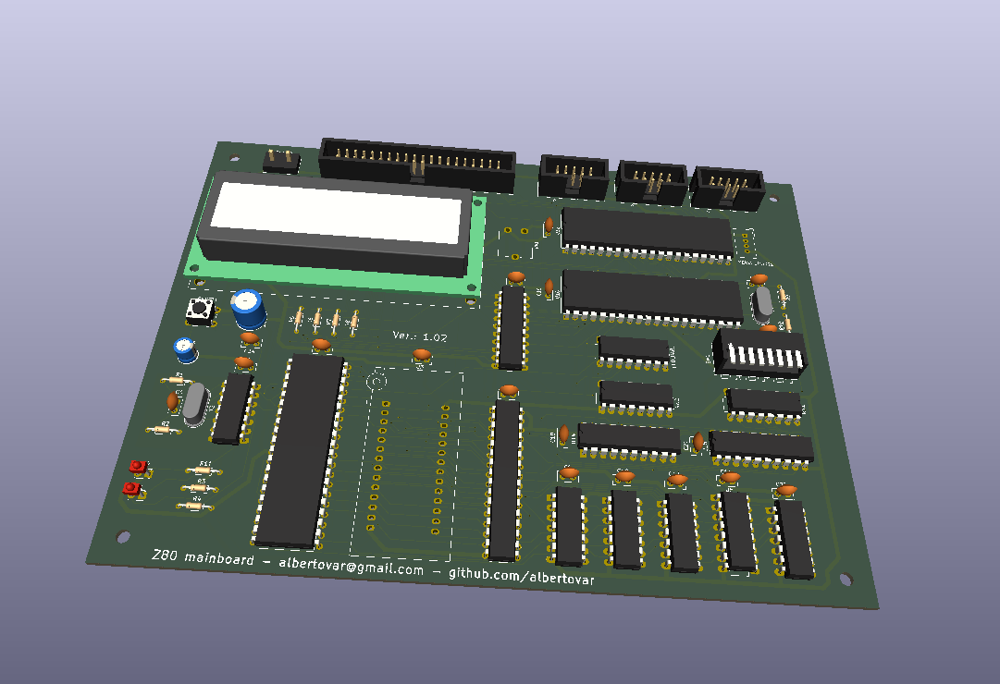

# Z80 Retro Computer



Zilog Z80A homebrew computer.

## Architecture
- CPU: SGS/ST Z8400AB1 Z80A, 4/8MHz.
- ROM: 28C256, 32 KiB;
- RAM: 24512AK, 64 KiB.
- Standard mode: ROM at 0000h–7FFFh; SRAM at 8000h–FFFFh.
- RAM_ONLY mode: SRAM at 0000h–FFFFh.
  
### Memory map

The Z80 has a 64 KiB address space. The board supports two memory configurations:

#### Standard mode (ROM enabled)

| Z80 address range | Size | Device | Description |
|---|---:|---|---|
| `0000h–7FFFh` | 32 KiB | AT28C256 EEPROM | ROM at the bottom of memory; execution after reset starts here. |
| `8000h–FFFFh` | 32 KiB | SRAM | RAM in the upper half; first RAM address is `8000h`. |

The monitor reserves `F000h–FFFFh` for its buffer, variables and stack. This is a firmware convention, not a hardware reservation.

#### RAM_ONLY mode (ROM disabled)

| Z80 address range | Size | Device | Description |
|---|---:|---|---|
| `0000h–FFFFh` | 64 KiB | SRAM | SRAM occupies the entire address space; ROM is not visible. |

A proposed RAM_ONLY software layout is monitor at `0000h–0FFFh` and user RAM at `1000h–FFFFh`. **This layout and the ROM-to-RAM transition are not implemented or validated yet.**

| Feature | Standard mode | RAMONLY mode |
|---|---|---|
| `0000h–7FFFh` | ROM | SRAM |
| `8000h–FFFFh` | SRAM | SRAM |
| Reset vector `0000h` | ROM | SRAM (must contain valid startup code) |
| RAM available in hardware map | 32 KiB | 64 KiB |

| Port range | Peripheral | Decoder output |
|---|---|---|
| 00h–07h | WD8250 UART | Y0 |
| 08h–0Fh | 82C55 PPI | Y1 |
| 10h–17h | 74HC273 CONTROL latch | Y2 |
| 18h–1Fh | HD44780 LCD | Y3 |
| 20h–27h | LEDs | Y4 |
| 28h–2Fh | Switches / 74HC244 | Y5 |
| 30h–37h | Expansion A | Y6 |
| 38h–3Fh | Expansion B | Y7 |

### Peripherals
- UART: 1.8432 MHz clock, 115200 baud, 8N1, divisor 1.
- PPI: 3 port, 8 bits, I/O general purpose.
- LCD display.
- 8 bit Switches for general purpose.
- 8 bit LEDs for general purpose.

### Boot and monitor
The planned ROM startup performs LCD/banner display, UART initialization, CRC verification and monitor copying. Proposed RAMONLY layout: monitor at 0000h–0FFFh and user RAM at 1000h–FFFFh. **Not implemented or validated yet.** SRAM A15 gating, the copy algorithm and the ROM-disable trampoline require schematic and ASM review.

### ROM CRC
CRC-16/CCITT-FALSE, initial value FFFFh, polynomial 1021h, MSB-first; covers bytes 0000h–7FFDh; CRC stored at 7FFEh–7FFFh. ROM image is padded to 32768 bytes.

## Programming workflow

The firmware workflow has two paths: creating and programming the boot ROM, and loading test or application binaries into SRAM.

### Build and program the ROM

1. Assemble the monitor ASM source with `z80asm` to produce a raw binary.
2. Run `firmware/utils/make_rom.py` on that binary. It pads the image to 32 KiB, calculates the CRC-16/CCITT-FALSE value and stores it in the final two bytes.
3. Program the generated CRC image (not the raw assembler output) into the AT28C256 using the T48 programmer and Minipro.

Example commands (run from the repository root):

```sh
z80asm -o monitor.bin monitor.asm
python3 firmware/utils/make_rom.py monitor.bin monitor_CRC.bin
minipro -p AT28C256 -w monitor_CRC.bin -s
```

### Serial console

A serial terminal can be opened with `screen` at 115200 baud:

```sh
screen /dev/ttyUSB0 115200
```

Replace `/dev/ttyUSB0` with the serial device assigned to the board if it differs. To exit `screen`, press `Ctrl+A`, then `K`, then confirm with `Y`.

### Load a binary into SRAM over UART

1. Assemble the test or application ASM source into a binary.
2. Connect to the board's UART (115200 baud, 8N1).
3. Run `firmware/utils/sendbin.py` with the serial device, hexadecimal load address and binary filename. The script asks the monitor to receive the file, waits for `READY`, transfers the binary and waits for `loadbin complete`.

Example:

```sh
python3 firmware/utils/sendbin.py /dev/ttyUSB0 8000 SWITCHES_monitor.bin
```

In **standard memory mode**, SRAM starts at `8000h`. The current utility accepts load addresses from `8000h` through `EFFFh` and prevents transfers from entering the monitor's reserved `F000h–FFFFh` area. RAM_ONLY loading is not currently supported by this utility.

Requirements: `z80asm`, Python 3, `pyserial` and `minipro` (with a T48 programmer for EEPROM programming).

See the [monitor firmware README](firmware/monitor/README.md) for the detailed commands, script behavior and implementation notes.

## Documentation

### Component datasheets

The following references cover the main ICs and modules listed in the hardware BOM (`hardware/schematic/CPU.csv`).

| Component | Datasheet / reference |
|---|---|
| Z80A CPU (Z8400) | [Zilog Z80 CPU User Manual (PDF)](https://www.zilog.com/docs/z80/um0080.pdf) — architecture, timing, registers and instruction set. |
| AT28C256 EEPROM | [Microchip AT28C256 datasheet (PDF)](http://ww1.microchip.com/downloads/en/DeviceDoc/doc0006.pdf) |
| W24512AK SRAM | [Winbond W24512A datasheet](https://www.alldatasheet.com/datasheet-pdf/pdf/47634/WINBOND/W24512A.html) |
| WD8250 UART | Datasheet link pending; the exact manufacturer/variant reference has not yet been recorded in the BOM. |
| 82C55A PPI | [82C55A datasheet (PDF)](http://jap.hu/electronic/8255.pdf) |
| 74HC14 | [TI SN74HC14 datasheet](https://www.ti.com/lit/gpn/sn74HC14) |
| 74HC138 | [TI SN74HC138 datasheet (PDF)](https://www.ti.com/lit/ds/symlink/sn74hc138.pdf) |
| 74HC273 | [Nexperia 74HC/HCT273 datasheet (PDF)](https://assets.nexperia.com/documents/data-sheet/74HC_HCT273.pdf) |
| 74HC04 | [Nexperia 74HC/HCT04 datasheet (PDF)](https://assets.nexperia.com/documents/data-sheet/74HC_HCT04.pdf) |
| 74HC08 | [TI SN74HC08 datasheet (PDF)](https://www.ti.com/lit/ds/symlink/sn74hc08.pdf) |
| 74HC32 | [TI SN74HC32 datasheet](https://www.ti.com/lit/gpn/sn74HC32) |
| 74HC02 | [TI SN74HC02 datasheet](https://www.ti.com/lit/gpn/sn74hc02) |
| 74HC244 | [Nexperia 74HC/HCT244 datasheet (PDF)](https://assets.nexperia.com/documents/data-sheet/74HC_HCT244.pdf) |
| L7805 voltage regulator | [ST L7805 datasheet (PDF)](https://www.st.com/resource/en/datasheet/l7805.pdf) |
| WC1602A LCD module | [Wincom WC1602A datasheet (PDF)](http://www.wincomlcd.com/pdf/WC1602A-SFYLYHTC06.pdf) |
| LED bar | [Broadcom LED bar datasheet (PDF)](https://docs.broadcom.com/docs/AV02-1798EN) |
| Reset pushbutton | [APEM/MEC Multimec switch series datasheet (PDF)](https://www.apem.com/medias/download/MEC_switches_serie_MULTIMEC5E.pdf) |

The BOM also includes standard passive parts (resistors, capacitors, resistor networks), connectors, a DIP switch and 1.8432 MHz / 4 MHz crystals. Their exact manufacturer part numbers are not specified in the current BOM, so individual datasheet links are not listed here. The 74HC138 reference above is for the actual 138 decoder; the BOM's existing URL points to a 238-family document and should not be used for the 74HC138.

### Z80 instruction set

- [Zilog Z80 CPU User Manual (UM008011)](https://www.zilog.com/docs/z80/um0080.pdf) — official CPU manual, including the documented instruction set, addressing modes, flags, timing and opcode information.
- [Z80 instruction-set reference and opcode tables](https://www.z80.info/) — searchable online reference material and instruction tables.

For project-specific hardware and firmware details, see the architecture documents and the [monitor firmware README](firmware/monitor/README.md).

## Validated status
Reset, ROM fetch, execution, HALT, ROM/RAM decoding, LCD, UART, switches and LEDs. Available troubleshooting tools: multimeter, continuity checks, switches and LEDs; no oscilloscope or logic analyzer.

## Documentation
- [Master project context](PROJECT_CONTEXT.md)
- [Memory map](architecture/memory_map.md)
- [Memory decoder](architecture/memory_decoder.md)
- [I/O map](architecture/io_map.md)
- [Boot sequence](architecture/boot_sequence.md)
- [UART](architecture/uart.md)
- [LCD](architecture/lcd.md)
- [Hardware notes](hardware/hardware_notes.md)
- [Prompts](prompts/README.md)
- [Changelog](CHANGELOG.md)

**Status labels:** CONFIRMED = validated; PROPOSED = not implemented; PENDING = requires review or testing. Avoid unnecessary changes to the fabricated PCB.
